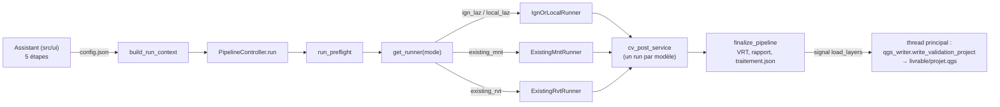

# Archéolog'IA — plugin QGIS

Archéolog'IA transforme des nuages de points LiDAR HD de l'IGN en images du relief lisibles par un archéologue (modèle numérique de terrain, ombrages, facteur de vue du ciel, dominance locale…), puis y cherche des structures archéologiques avec des modèles de détection, et livre un projet QGIS prêt à valider. Il s'adresse aux services d'archéologie et aux prospecteurs qui travaillent sous QGIS, sans compétence en traitement de données.

- Nom du plugin : **Archéolog'IA**
- Version : **0.16.1**
- QGIS : **3.34 ou plus récent, QGIS 4 compris** (Qt5 et Qt6, un seul code), Windows
- Documentation utilisateur : le **manuel intégré** (menu Extensions → Archéolog'IA → Manuel, bouton « Aide » ou F1 dans l'assistant), dont la source est le dossier [`aide/`](aide/), livré avec le plugin
- Journal des versions : le champ `changelog` de [`metadata.txt`](metadata.txt), rendu dans le chapitre « Nouveautés » du manuel
- Licence : MIT ([`LICENSE.txt`](LICENSE.txt)) ; la bibliothèque Relief Visualization Toolbox embarquée est sous Apache 2.0 (voir [Licence](#licence))

## Obtenir le plugin

Le plugin se distribue par un **dépôt d'extensions QGIS privé**, dont l'adresse et les identifiants sont communiqués par l'équipe aux services utilisateurs : QGIS l'installe et le met à jour comme n'importe quelle extension. La procédure est au chapitre « Installer et mettre à jour » du manuel ([`aide/01-installer.md`](aide/01-installer.md)).

Ce dépôt GitHub porte le **code source**. Il ne contient ni les modèles de détection (`data/models/`), ni le moteur de détection compilé (`data/third_party/`), ni la grille des dalles décompressée : un clone permet de lire, tester et modifier le code, mais pas de lancer une détection. Les tests automatiques tournent sans QGIS (voir [Développement](#developpement)).

## Ce que fait le plugin

[](aide/img/pipeline.png)

Un assistant en cinq étapes (source et mode, produits, détection, vérifications, traitement) enchaîne :

1. le **téléchargement** des dalles LiDAR HD depuis la Géoplateforme de l'IGN, ou l'import de nuages locaux ;
2. la **fusion** de chaque dalle avec ses voisines, avec une marge, puis le **MNT** (sol nu), la **densité** et la **couverture** (qualité de la donnée) ;
3. quinze **produits de visualisation** du relief, calculés par la bibliothèque Relief Visualization Toolbox intégrée : HS, M-HS, SVF, OPNS, SLO, LD, SLRM, VAT, CVAT, MSTP, PRISM, CRIM, plus MNT, densité et couverture ;
4. la **détection** d'entités archéologiques (parcellaire, charbonnières, cratères, enclos, tranchées…) par des modèles ONNX, sur l'indice que chaque modèle a appris ; les détections sont dédoublonnées entre dalles, filtrées par seuil et aire minimale, éventuellement regroupées en zones, et classées en quatre niveaux de **fiabilité** mesurés à l'évaluation du modèle ;
5. l'**assemblage** : mosaïques des rasters, un GeoPackage par entité, un projet QGIS stylé (`livrable/projet.qgs`), un rapport (`livrable/rapport.html`) et une trace (`livrable/traitement.json`).

Quatre **modes** entrent dans cette chaîne à des endroits différents :

| Mode | Vous fournissez | Ce qui est calculé |
|---|---|---|
| `ign_laz` · Téléchargement IGN | une zone d'étude, une liste de dalles ou une sélection sur la carte | tout |
| `local_laz` · Nuages locaux | un dossier de `.laz` / `.las` | tout, sans téléchargement |
| `existing_mnt` · MNT existant | un dossier de MNT (`.tif`, `.asc`), en Lambert-93 | indices et détection |
| `existing_rvt` · Indices existants | un dossier d'indices `.tif`, en Lambert-93 | détection seule (ou publication des indices en mosaïque) |

Le détail de chaque écran, des réglages et des sorties est dans le manuel, pas ici.

## Pré-requis

- **QGIS 3.34+ ou 4.x** avec son module Processing. Aucune extension tierce : les indices sont calculés par la copie de la bibliothèque `rvt` embarquée (`src/pipeline/ign/products/rvt_embarque/`).
- **PDAL** (`pdal`) pour lire les nuages de points (modes `ign_laz` et `local_laz`) ; l'installation OSGeo4W de QGIS le fournit.
- **GDAL** en ligne de commande : `gdalwarp`, `gdal_translate`, `gdaladdo`.
- **Détection** : le moteur `cv_runner_onnx` compilé (`data/third_party/cv_runner_onnx/windows/cv_runner_onnx.exe`, livré dans le ZIP du dépôt privé, environ 210 Mo) et des modèles installés dans `data/models/`. Côté plugin, `shapely` et `geopandas` de l'environnement QGIS servent au post-traitement et à l'écriture des GeoPackages. Sans le moteur, la détection est impossible et l'étape 4 le dit.
- **Carte graphique** (facultatif, Windows) : le moteur est compilé avec DirectML ; l'option de l'étape 4 vérifie la carte contre le processeur au premier usage de chaque modèle et ne la garde que si elle est plus rapide et donne les mêmes détections.
- **Réseau d'entreprise** : le téléchargement des dalles passe par le proxy déclaré dans QGIS (Préférences → Options → Réseau), à défaut par `HTTP_PROXY` / `HTTPS_PROXY`. L'authentification NTLM / Kerberos n'est pas prise en charge.

Le panneau « État du système » de l'étape 4 vérifie tout cela avant le lancement.

> **Faux positif antivirus.** `cv_runner_onnx.exe` est compilé avec PyInstaller et non signé : certains antivirus le mettent en quarantaine à tort. Restaurez-le et ajoutez une exception sur `data/third_party/cv_runner_onnx/`.

## Sorties

Deux racines, une règle : `livrable/` se garde et se transmet, `technique/` se supprime.

```text
dossier_de_sortie/
├── livrable/
│   ├── projet.qgs                         projet QGIS stylé : le point d'entrée
│   ├── rapport.html                       rapport du traitement, sans chemin de poste
│   ├── traitement.json                    trace du dernier traitement (plugin_version, arborescence: 3)
│   ├── indices/<PRODUIT><réglages>/tif/   GeoTIFF par dalle + index_<PRODUIT>.vrt (mosaïque)
│   └── detections/<entité>/              <entité>.gpkg + fiabilite.json
└── technique/
    ├── sources/dalles/                    LAZ reçus (+ dalles_urls.txt), avec leur note « .verifie.json »
    ├── intermediaires/                    LAZ fusionnés, TIF non rognés (halo), sidecars de cache
    ├── png/<PRODUIT>/                     images préparées pour la détection
    ├── detection/<modèle>/                sorties brutes du moteur, images annotées
    └── journaux/                          pipeline_log_<date>.txt + metadata_<date>.json par lancement
```

- Le nom d'un dossier d'indice porte ses réglages (`SVF_R10_D16_V1_N0`, `LD_A15_Rmin10_Rmax20_H1p7_V1`, suffixe `_F32` pour une sortie flottante) : relancer avec d'autres réglages crée un dossier à côté au lieu d'écraser. Source unique : `src/pipeline/ign/products/rvt_naming.py`. En mode `existing_rvt`, tout va sous `livrable/indices/RVT/`.
- Les détections sont rangées **par entité** (`livrable/detections/<slug>/`), un GeoPackage par entité ; deux modèles comparés sur une même entité donnent `<slug>--<modèle>/`.
- Relancer dans le même dossier réutilise ce qui est à jour : les réglages de fusion et de MNT sont suivis par un sidecar (`technique/intermediaires/run_params.json`), un changement invalide le cache et le journal le dit (« Méthode de calcul mise à jour », « Paramètres de traitement modifiés »). `livrable/indices/`, `technique/sources/` et `livrable/detections/` ne sont jamais purgés.
- Un dossier écrit par une version antérieure (`indices/`, `detections/`… à la racine) est réorganisé **sur proposition** au lancement (`src/app/services/arborescence.py`).

## Développement

Deux contextes d'exécution, et la plupart des surprises viennent de leur confusion :

1. **Dans QGIS** : `main.py` charge `src/ui/wizard_dialog.py` (assistant, pages dans `src/ui/steps/`, vue d'exécution `src/ui/run_view.py`) ; le lancement passe par un thread de travail et `src/app/pipeline_controller.py`, qui vérifie l'environnement (`src/pipeline/preflight.py`), choisit le runner du mode (`src/app/runners/registry.py`) et termine par `src/app/services/finalize_service.py`. Les modules de `src/pipeline/` importent QGIS.
2. **Hors QGIS** : les tests et l'outillage de `dev/`. `src/app/` et les helpers purs se testent directement ; `src/ui/` et `src/pipeline/` ne sont pas collectés par pytest.



Les règles qui ne se devinent pas depuis l'arborescence (compatibilité Qt5/Qt6, invariants des seuils et de la symbologie, halo inter-dalles, nommage des indices, carte graphique, livraison) sont dans [`CLAUDE.md`](CLAUDE.md) et [`docs/contrats.md`](docs/contrats.md).

### Arborescence

```text
main.py, metadata.txt           point d'entrée QGIS, identité et changelog du plugin
aide/                           manuel intégré (un chapitre Markdown par écran, images)
src/app/                        orchestration : contrôleur, runners par mode, services purs (orchestrateur de modèles, fiabilité, rapport…)
src/pipeline/                   métier : téléchargement et fusion IGN, MNT, indices (rvt_embarque), détection (cv/), modes
src/ui/                         assistant Qt : pages, widgets, vue d'exécution, chargement des couches, écriture du .qgs
src/config/                     lecture et écriture de la configuration
data/                           entities_catalog.json, indices_fiches.json, zones_corpus.json, icônes ; models/ et third_party/ non versionnés ; quadrillage_france.zip (grille IGN compressée, décompressée au premier besoin)
tests/                          pytest (unit/, integration/) et TESTS_MANUELS_QGIS.md (recette dans QGIS)
dev/                            outillage, exclu du ZIP : packaging, grille IGN, export ONNX et compilation du moteur, rendus hors écran, schéma du pipeline
docs/                           contrats, contrat des modèles (model_contract.md)
scripts/                        validateur des métadonnées de modèles
```

### Tests

```bash
pip install -r dev/requirements/test.txt
python run_tests.py                       # tous les tests, sans QGIS
python run_tests.py unit                  # tests unitaires seulement
python run_tests.py -k detection          # filtre par nom
ruff check src/
```

Ce que pytest ne couvre pas se vérifie dans QGIS : la recette `tests/TESTS_MANUELS_QGIS.md`, et les rendus hors écran de l'assistant et du manuel (`dev/rendu_hors_ecran.py`, à lancer avec le Python de QGIS, sous QGIS 3 et QGIS 4).

### Hooks git

Le dépôt fournit un hook `pre-push` dans `.githooks/` (lint, validateur des modèles, et Talisman contre les secrets). À activer une fois par clone, avec `talisman` dans le `PATH` :

```bash
git config core.hooksPath .githooks
```

### Modèles de détection

Un modèle vit dans `data/models/<nom>/` : `model_card.yaml` (couverture des entités, seuils, fiabilité, fiches), `args.yaml` (fenêtres SAHI, regroupement, post-traitement), `classes.txt`, `config.json`, `training_params.json`, `weights/best.onnx` et son sidecar `weights/best.json`, plus l'évaluation. Le contrat complet est dans [`docs/model_contract.md`](docs/model_contract.md) et se vérifie par :

```bash
python scripts/validate_models_metadata.py                 # tous les modèles
python scripts/validate_models_metadata.py data/models/X   # un seul
```

L'étape 3 de l'assistant ne montre pas de modèles mais des **entités** : `data/entities_catalog.json` donne le vocabulaire, et le `model_card.yaml` de chaque modèle déclare les entités qu'il couvre ; l'orchestrateur `src/app/services/model_orchestrator.py` en déduit les runs (un modèle, un indice cible, des classes), écrits dans `computer_vision.runs` de la configuration. Un modèle conforme déposé dans `data/models/` couvre ses entités sans autre déclaration. Deux modèles cochés pour une même entité donnent deux runs comparés dans QGIS.

Le seuil de confiance par défaut d'une entité est choisi **sous** le seuil du F1 maximal mesuré à l'évaluation, dans la fenêtre documentée par `thresholds.seuils_provenance` du `model_card.yaml` : en prospection, une structure manquée ne se rattrape pas alors qu'une fausse détection s'écarte en quelques secondes.

Exemple d'`args.yaml` avec regroupement :

```yaml
imgsz: 648
model: RF-DETR-Seg-Large
task: instance_segmentation

sahi:
  overlap_ratio: 0.2
  slice_height: 648
  slice_width: 648

postprocess:                 # facultatif ; défauts : merge_adjacent=true, remove_overlaps=true, merge_buffer_m=0.5
  merge_adjacent: false      # ex. cratères disjoints : on ne fusionne pas
  remove_overlaps: true
  merge_buffer_m: 0.5

clustering:                  # facultatif ; absent = pas de regroupement
  - target_classes: ["cratere_obus"]
    eps_m: 25
    min_cluster_size: 3
    min_samples: 2
    min_confidence: 0.3
    min_confidence_extend: 0.1     # hystérésis : seuil bas pour rattacher sans ouvrir une zone
    output_class_name: "zone_crateres"
    output_geometry: convex_hull   # convex_hull | concave_hull | bounding_box
    buffer_m: 5
    min_area_m2: 500
    min_conf_p90: 0.60             # filtre de zone : 90e centile de confiance des membres
    max_elong_med: 1.32            # filtre de zone : élongation médiane des boîtes
```

Une sortie de regroupement peut être exposée comme entité à part entière (`derived_targets` du `model_card.yaml`) ; c'est ainsi que « Regroupement de cratères » apparaît à l'étape 3.

### Détection : moteur et halo inter-dalles

L'**inférence** est faite par le programme externe `cv_runner_onnx` (source dans `dev/runner_onnx/`), qui ne produit que des détections brutes. Tout le reste (GeoPackages, fusion des polygones, suppression des superpositions, regroupement DBSCAN, filtrage par seuil et par aire, fiabilité) est fait côté plugin, sous `src/pipeline/cv/`. Le moteur ne dépend ni de `shapely` ni de `geopandas`.

Les images analysées débordent de la dalle : en modes LiDAR, le PNG vient du TIF **non rogné** de `technique/intermediaires/` (dalle + marge) ; en modes `existing_mnt` et `existing_rvt`, un halo de 50 m est fabriqué depuis les dalles voisines du dossier (`src/pipeline/modes/neighbor_halo.py`). Un objet à cheval sur une frontière est vu entier par l'une des deux dalles, et chaque dalle ne rapporte que les détections dont le **centre est dans sa cellule** : ni doublon, ni fragment au bord. Les détections sont de plus découpées à l'union des emprises du run.

Un MNT ou un indice de plus de 1,05 km dans une dimension est traité **d'un bloc** (pas de pré-découpage : SAHI découpe en mémoire à l'inférence), un raster de moins d'un kilomètre garde son emprise native. Les entrées doivent être en Lambert-93 (EPSG:2154).

### Exporter un modèle vers ONNX

```bash
pip install -r dev/requirements/export.txt          # torch, onnx, onnxsim… (rfdetr ou ultralytics selon le modèle)
python dev/runner_onnx/export_to_onnx.py --model data/models/<nom>/weights/best.pth --output data/models/<nom>/weights/best.onnx --type rfdetr
```

Le script détecte le type de modèle (YOLO, RF-DETR, RF-DETR Seg, SegFormer, SMP), écrit le `.onnx` et son sidecar `.json`, et copie `classes.txt` et `args.yaml` s'ils sont présents. Pour RF-DETR, la classe et la résolution sont lues dans le checkpoint (`model_name`, `model_config`, écrits par rfdetr ≥ 1.8) ; `--patch-size` et `--positional-encoding-size` ne servent qu'à forcer une valeur. Un modèle SMP prend `--arch`, `--encoder`, `--num-classes`, `--class-names` et `--imgsz`. L'export et la porte de parité ONNX ⇄ PyTorch sont décrits dans [`docs/model_contract.md`](docs/model_contract.md).

### Compiler le moteur de détection

```bash
pip install -r dev/requirements/build.txt
python dev/runner_onnx/build.py            # Windows : DirectML (processeur + carte graphique) ; ailleurs : processeur
python dev/runner_onnx/build.py --cpu      # processeur seul
python dev/runner_onnx/build.py --gpu      # CUDA
python dev/runner_onnx/build.py --clean    # nettoyer
```

Le script crée un venv isolé (`dev/runner_onnx/.venv_onnx`), compile avec PyInstaller et copie le binaire dans `data/third_party/cv_runner_onnx/<os>/` avec un `build_info.json` (commit, empreinte des sources, version d'onnxruntime). Le test `test_binaire_a_jour` est rouge dès que `src/pipeline/cv/` change sans recompilation.

### Packager le plugin

```bash
python dev/package_plugin.py
```

Produit `archeologia.<version>.zip` (version lue dans `metadata.txt` ; le préfixe `archeologia` est le nom du dossier d'installation attendu par QGIS) et un `plugins.xml` pour le dépôt. Le ZIP exclut `dev/`, `tests/`, `docs/`, `scripts/`, les fichiers de développement, les checkpoints `.pt`/`.pth` et le catalogue privé ; il embarque la grille IGN décompressée avec son index spatial, les modèles et le moteur présents sur le poste. La procédure complète de livraison (grille IGN à jour, manuel, binaire, bump, PR, tag) est le runbook `.claude/commands/livraison.md`.

## Licence

Le dépôt est sous licence MIT ([`LICENSE.txt`](LICENSE.txt)).

Le dossier `src/pipeline/ign/products/rvt_embarque/` contient une copie de la bibliothèque `rvt` de l'extension Relief Visualization Toolbox (rvt-qgis 1.0.1, ZRC SAZU et Université de Ljubljana, UL FGG), sous licence Apache 2.0 : voir son `LICENSE` et son `NOTICE` (imports internes rendus relatifs, aucun calcul modifié).
