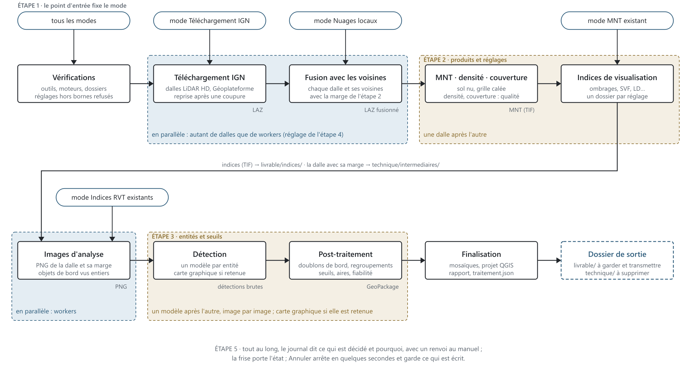

# Premier traitement

Un parcours complet sur quelques dalles LiDAR HD de l'IGN, pour voir ce que produit le plugin avant de régler quoi que ce soit. Vous avez besoin d'une connexion Internet et d'un dossier vide sur un disque avec de la place.

## Ce que fait le plugin

À partir d'une zone et de données LiDAR, le plugin enchaîne automatiquement :

1. le **téléchargement** ou l'import des nuages de points ;
2. la **fusion** de chaque dalle avec ses voisines, avec une marge, puis le calcul du **modèle numérique de terrain** (MNT) ;
3. le calcul des **images du relief** du relief (ombrages, facteur de vue du ciel, dominance locale…) ;
4. la **détection automatique** de structures archéologiques par des modèles de détection, si vous l'activez ;
5. l'**assemblage** : mosaïques des rasters, GeoPackages de détections et un projet QGIS prêt à ouvrir.

Selon vos données, vous entrez dans cette chaîne à un endroit différent : c'est le **point de départ**, choisi à l'étape 1. Le schéma montre où entre chaque point de départ, ce qui se fait dalle par dalle en parallèle, et ce qui finit dans `livrable/` (à garder) ou dans `technique/` (à supprimer).

## Ce manuel

Le bouton **Aide** de l'assistant et la touche **F1** ouvrent ce manuel sur le chapitre de l'étape affichée ; l'entrée **Aide** du menu Extensions › Archéolog'IA l'ouvre aussi. Après une mise à jour, le bouton porte une pastille et le manuel s'ouvre une fois sur les **Nouveautés**.

Dans la fenêtre : le sommaire à gauche, le texte à droite. **Ctrl+F** cherche dans tout le manuel : les occurrences s'affichent dans le sommaire, par chapitre et par section, et un clic saute dedans ; Entrée ou **F3** passe à la suivante dans le chapitre ouvert, vider le champ rend le sommaire. Les flèches **Précédent** et **Suivant** (Alt+← et Alt+→) rejouent la navigation après un lien. **Ctrl+molette** règle la taille du texte, Ctrl+0 la remet. **Exporter en PDF** écrit le manuel complet dans un fichier.

## L'assistant en six étapes

Le plugin s'ouvre sur un assistant : un rail à gauche indique l'étape courante, **Précédent** et **Suivant** en bas. Les quatre premières étapes préparent le traitement, la cinquième le suit, la sixième, **Résultats**, retrouve les traitements lancés depuis ce poste. Le rail signale par une pastille toute erreur qui empêcherait de lancer. Vos choix sont sauvegardés en continu : à la réouverture, vous retrouvez vos derniers réglages. Le bouton **Aide** en haut à droite, ou la touche **F1**, ouvre le chapitre de cette aide qui correspond à l'étape affichée.

## Étape 1 · Vos données

Cliquez **Dalles IGN à télécharger** sur la frise : c'est le point de départ Téléchargement IGN. Puis :

- **Choisir sur la carte** : la grille des dalles LiDAR HD s'affiche sur le canevas de QGIS. Zoomez jusqu'à ce que les dalles apparaissent, cliquez-en trois ou quatre contiguës, puis **Valider**. Vous pouvez aussi donner un fichier de zone d'étude (polygone ou points) : toutes les dalles qu'il touche sont retenues.
- **Dossier de sortie** : un dossier vide.

Détail dans [Étape 1 · Vos données](etape-1-source.md).

## Étape 2 · Images du relief

Les trois images recommandées sont déjà cochées : le **MNT** (le relief nu), **SVF** (facteur de vue du ciel, qui révèle les creux) et **LD** (dominance locale, qui fait ressortir les reliefs). Chaque carte a une vignette et un bouton **ⓘ** qui explique ce que montre l'image et ce qu'elle ne montre pas ; le lien **Comparer les images** dit laquelle choisir pour quel type de vestige.

Laissez les réglages par défaut. Détail dans [Étape 2 · Images du relief](etape-2-produits.md).

## Étape 3 · Structures à chercher

Activez la détection, puis cochez une structure, par exemple **Parcellaire** ou **Cratères**. Vous ne choisissez pas de modèle : le plugin retient le modèle entraîné pour cette structure et vérifie que l'image dont il a besoin est bien cochée à l'étape 2 (sinon, un bouton **+ Cocher** l'ajoute). Le bouton **ⓘ** de chaque structure ouvre sa fiche dans le panneau de droite, sans bloquer la page : à quoi ressemble la structure sur le relief et où le modèle l'a apprise.

Détail dans [Étape 3 · Structures à chercher](etape-3-detection.md).

## Étape 4 · Prêt à lancer

Le bandeau du haut dit si tout est prêt ; le panneau **Environnement** vérifie les outils du poste. Cliquez **Lancer le traitement**.

Détail dans [Étape 4 · Prêt à lancer](etape-4-verifications.md).

## Étape 5 · Traitement

L'assistant passe à l'étape 5 : une frise des phases, avec leur compteur et leur chronomètre, et un journal. La durée dépend du nombre de dalles, des images cochées et de votre machine ; le journal donne l'avancement réel, dalle par dalle.

Détail dans [Étape 5 · Traitement](etape-5-traitement.md).

## À la fin

Le cadre **Par où commencer** apparaît sous la frise. **Ajouter au projet QGIS courant** y charge les mosaïques des images du relief et, par structure, un GeoPackage de détections avec sa légende de fiabilité ; **Ouvrir livrable/projet.qgs** ouvre le projet du dossier de sortie à la place du projet courant. Le projet `livrable/projet.qgs` dans le dossier de sortie regroupe tout, déjà stylé : c'est le point d'entrée pour valider les détections.

Ce qu'il y a dans le dossier de sortie et comment le lire : [Vos résultats dans QGIS](resultats.md).

## Au clavier

Tab passe de commande en commande et un liseré bleu dit où l'on est ; Espace coche une image ou une structure, Entrée ouvre l'étape du rail de gauche ou le bouton qui a le focus ; Échap ferme le panneau des fiches, puis la fenêtre. Un bouton grisé porte une bordure pointillée, lisible sans la couleur.

