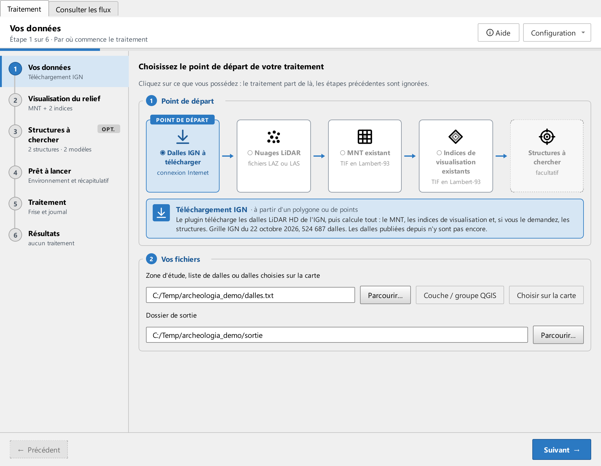
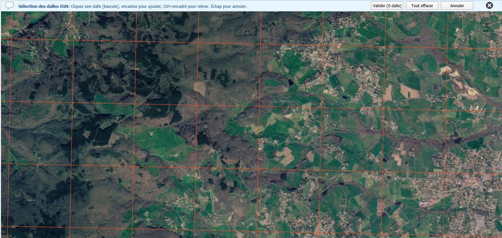

# Étape 1 · Vos données

La frise du haut représente la chaîne de traitement (le [schéma complet](premier-traitement.md#ce-que-fait-le-plugin) est au chapitre Premier traitement). Cliquez sur ce que vous possédez déjà : c'est le **point de départ** du traitement, marqué d'un badge et rappelé dans un bandeau. Les étapes qui le précèdent sont ignorées et disent « sautée » : le traitement ne passe pas par là. Le champ de vos fichiers s'adapte. Il n'y a pas de liste déroulante ; au clavier, la touche Tab passe d'un point de départ à l'autre et Espace le choisit.

## Les quatre points de départ

| Point de départ | Vous fournissez | Internet |
|---|---|---|
| Dalles IGN à télécharger | une zone d'étude, une liste de dalles, ou des dalles choisies sur la carte | oui |
| Nuages LiDAR | un dossier de fichiers `.laz` ou `.las` | non |
| MNT existant | un dossier de modèles de terrain `.tif`, `.tiff` ou `.asc`, dans un système de coordonnées projeté en mètres | non |
| Indices de visualisation existants | un dossier d'indices (SVF, LD…) `.tif`, dans un système de coordonnées projeté en mètres | non |

Les deux premiers points de départ exécutent toute la chaîne. Depuis un MNT existant, le traitement commence aux indices de visualisation. Depuis des indices de visualisation existants, il ne calcule aucun produit : avec une structure cochée, il les analyse ; sans détection, il se contente de les publier en mosaïque dans `livrable/indices/RVT/`.

Dans tous les cas, indiquez un **dossier de sortie**, de préférence vide. Relancer dans le même dossier est possible : voir [Relancer dans le même dossier](etape-5-traitement.md#relancer-dans-le-meme-dossier).

Sous chaque champ, une ligne dit ce qui manque et le geste à faire : « Indiquez la zone d'étude… », « Ce dossier est introuvable : vérifiez le chemin », « Ce dossier est dans le dossier de vos données : choisissez un dossier de sortie à part ». Elle disparaît quand le champ est bon, et dit « 3 dalles choisies sur la carte » après une sélection sur la carte. Le rail de gauche marque « à corriger » l'étape qui porte encore un problème.

## Nom de l'analyse

Sous le dossier de sortie, le **nom de l'analyse** est proposé d'après lui : le dossier qui le contient, puis le dossier de sortie, « be_vl · indices » pour un dossier de sortie `…\be_vl\indices`. Il suit le dossier de sortie tant que vous ne l'avez pas écrit vous-même ; une fois saisi, il ne bouge plus. Videz le champ pour revenir à la proposition.

Ce nom, suivi de la date et de l'heure du traitement, « be_vl · indices — 01/11/2026 14:05 », est celui du groupe qui réunit les couches du traitement dans QGIS (voir [Le projet de validation](resultats.md#le-projet-de-validation)) ; il titre aussi le rapport et figure dans la trace `traitement.json`. Il est enregistré avec la configuration et revient avec elle, comme avec **Relancer avec un seuil changé** ; une configuration enregistrée avant ce champ reprend la proposition.

## Téléchargement IGN

Le plugin identifie les dalles LiDAR HD de l'IGN qui couvrent votre zone, les télécharge depuis la Géoplateforme, puis traite. Trois façons de désigner les dalles :

- **Choisir sur la carte** : la grille nationale s'affiche sur le canevas de QGIS. Elle n'apparaît qu'à une échelle assez fine : zoomez sur votre secteur jusqu'à ce que les dalles soient dessinées (la barre de messages indique l'échelle requise). Cliquez une dalle pour la prendre ou la retirer, encadrez à la souris pour en ajouter plusieurs, **Ctrl** + encadrer pour en retirer, **Échap** pour abandonner. **Valider** enregistre la liste, avec une estimation du volume à télécharger. Pendant le choix, l'assistant ne se réduit pas : il se range contre le bord droit de l'écran, à sa largeur minimale, pour laisser le canevas libre, et reprend sa place à la fin.
- **Zone d'étude** : un fichier vectoriel (`.shp`, `.gpkg`, `.geojson`), polygone ou points, dans n'importe quelle projection. Toutes les dalles qui touchent l'emprise sont retenues.
- **Liste de dalles** : un fichier `.txt`, une dalle par ligne au format `nom,url`, tel que l'écrit la sélection sur carte ou tel que le fournit le site de téléchargement de l'IGN.

La grille des dalles est livrée avec le plugin et remise à jour à chaque version. Le bandeau du point de départ indique sa date et son nombre de dalles : les dalles publiées par l'IGN depuis cette date n'y figurent pas encore.

Chaque dalle couvre un kilomètre carré. Les dalles voisines sont fusionnées avant le calcul des produits, avec une marge, pour que les produits se raccordent sans couture : voir [Marge entre dalles](etape-2-produits.md#marge-entre-dalles).

## Nuages locaux

Vous avez déjà les fichiers `.laz` ou `.las`. Le plugin lit le dossier, reconnaît les dalles IGN à leur nom, fusionne les voisines et applique le même traitement que le point de départ Téléchargement IGN. Les fichiers doivent être en Lambert-93 ; ce n'est pas vérifié : un nuage dans une autre projection donne un MNT faux, sans message.

## MNT existant

Vous fournissez un dossier de modèles de terrain. Le plugin calcule les produits cochés à l'étape 2 puis, si elle est activée, la détection. Le relief nu et la qualité de la donnée ne sont pas proposés à l'étape 2 : le MNT existe déjà. Pour le système de coordonnées accepté, voir [Système de coordonnées des rasters fournis](etape-1-source.md#systeme-de-coordonnees-des-rasters-fournis).

Le plugin inspecte l'emprise de chaque raster :

- **dalle** d'un kilomètre, alignée sur le kilomètre (comme les dalles de l'IGN) : traitement habituel ;
- **petit raster**, moins d'un kilomètre ou non aligné : l'emprise est conservée telle quelle ;
- **grand raster**, plus d'un kilomètre dans une dimension : aucun pré-découpage, les produits sont calculés sur toute l'emprise et la détection découpe elle-même l'indice en fenêtres d'analyse.

Chaque raster est calculé seul, sans voisin : sur un lot de petites dalles, les indices à grand rayon peuvent montrer une couture entre deux dalles. La carte **Marge entre dalles** de l'étape 2 signale quand le rayon d'un indice dépasse ce que la dalle peut fournir.

## Indices de visualisation existants

Vous avez déjà les indices de visualisation (SVF, LD, M-HS…), par exemple produits par un traitement précédent ou par un autre outil. Le dossier est lu tel quel, les indices sont préparés pour les modèles et la détection s'exécute. Même règle de système de coordonnées que pour un MNT, ci-dessous : projeté, en mètres, un seul pour le dossier. Les résultats sont rangés sous `livrable/indices/RVT/`, le plugin ne connaissant pas les réglages qui ont produit ces images.

Pour que les objets à cheval sur deux dalles soient vus entiers, le plugin fabrique une marge à partir des dalles voisines présentes dans le dossier. Une dalle isolée n'en a pas.

## Système de coordonnées des rasters fournis

Les rasters fournis (MNT ou indices) peuvent être dans **n'importe quel système de coordonnées projeté en mètres** : Lambert-93 (EPSG:2154) en France, UTM en Allemagne ou en Norvège (EPSG:25832, 25833), British National Grid au Royaume-Uni (EPSG:27700), Irish Transverse Mercator (EPSG:2157), RD New aux Pays-Bas (EPSG:28992)… Ils ne sont **pas reprojetés** : une reprojection vers Lambert-93 déformerait les distances hors de France. Toutes les sorties sont écrites dans le système des rasters fournis : images, mosaïques, détections, projet QGIS ; la trace du traitement et le rapport le nomment.

La vérification de l'étape 4 affiche le système retenu, par exemple « EPSG:25832 · 205 dalle(s) », et refuse, avec un message qui le nomme :

- un système **géographique**, en degrés (EPSG:4326 par exemple) : les rayons des indices et les surfaces n'y ont pas de sens ;
- un système projeté qui n'est **pas en mètres** (en pieds par exemple) ;
- un **mélange** de systèmes entre les rasters d'un même dossier.

Dans ces trois cas, reprojetez les rasters dans un système projeté en mètres, le même pour tout le dossier, avant de relancer. Un raster **sans** système de coordonnées dans ses métadonnées est traité en Lambert-93 : la vérification le dit par un avertissement, le lancement reste possible.

Relancer dans un dossier de sortie déjà calculé dans un **autre** système (un premier traitement en Lambert-93, puis des MNT allemands) : la vérification l'avertit. Les indices du premier traitement restent dans le dossier et la mosaïque ne pourrait pas les assembler avec les nouveaux : choisissez un nouveau dossier de sortie.

## Enregistrer et recharger une configuration

Dans l'en-tête de l'assistant, le menu **Configuration ▾** réunit tout ce qui touche à vos réglages : **Enregistrer sous…** garde l'ensemble de vos choix sous un nom ; les configurations enregistrées se chargent d'un clic ; **Gérer les configurations…** les renomme ou les supprime ; **Importer un fichier…** lit une configuration reçue d'un collègue ; **Tout remettre aux valeurs par défaut…** revient aux réglages d'origine après confirmation. Ces configurations vivent dans votre profil QGIS, pas dans le dossier du plugin : elles survivent aux mises à jour. Pendant un traitement, charger, importer et tout remettre sont grisés ; enregistrer reste possible.
