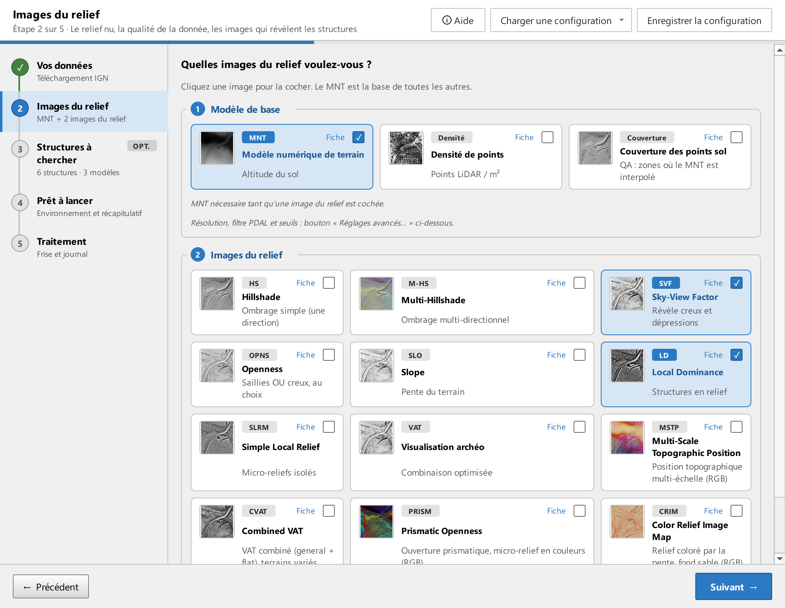
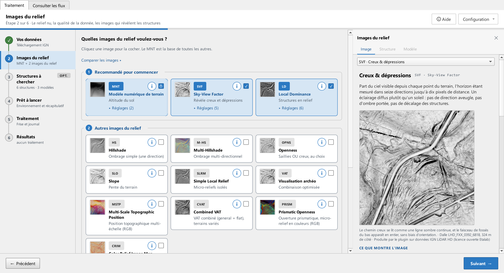

# Étape 2 · Produits

Cochez les produits à calculer pour chaque dalle. Chaque carte porte une vignette et un lien **Fiche** : ce que montre l'image, dans quelle optique s'en servir, ce qu'elle ne montre pas, comment elle est calculée, ses réglages et ses sources. Avant de choisir entre deux indices, ouvrez **Comparer les produits**, en tête de la liste des fiches : deux tableaux issus de la documentation de Relief Visualization Toolbox disent quel produit convient à quel type de forme.

## Les produits

| Famille | Sigle | Ce que c'est |
|---|---|---|
| Base | MNT | Modèle numérique de terrain : l'altitude du sol nu, à partir des points classés sol. Base de tous les indices |
| Qualité | Densité | Nombre de points LiDAR sol par cellule : où la donnée est dense ou clairsemée |
| Qualité | Couverture | Part des cellules réellement appuyées sur des points sol : signale les zones où le MNT n'est qu'une interpolation. Modes LiDAR seulement |
| Relief | HS | Ombrage simple, depuis une seule direction de lumière |
| Relief | M-HS | Ombrage multi-directionnel : plusieurs éclairages combinés, pour le micro-relief |
| Relief | SVF | Facteur de vue du ciel : part de ciel visible en chaque point. Révèle creux, fossés et dépressions |
| Relief | OPNS | Ouverture du relief. Un réglage choisit le type : positive pour les saillies, négative pour les creux |
| Relief | SLO | Pente du terrain : ruptures de pente et talus |
| Relief | LD | Dominance locale : fait ressortir les structures en relief |
| Relief | SLRM | Modèle de relief local : soustrait le relief général pour isoler le micro-relief |
| Composition | VAT | Visualisation archéologique : combinaison d'indices optimisée pour la prospection |
| Composition | CVAT | VAT combiné : fusion des variantes terrain général et terrain plat |
| Composition | MSTP | Position topographique multi-échelle : trois échelles composées en une image couleur |
| Composition | PRISM | Ouverture prismatique : ouvertures positive et négative sur un ombrage multi-directionnel, en couleurs |
| Composition | CRIM | Relief coloré : le micro-relief en gris, la pente en couleurs |

Les détails de calcul et de lecture sont dans la fiche de chaque produit, pas ici.

## Ce qu'il faut savoir avant de cocher

- **Le MNT est requis** tant qu'un indice de relief est coché : il en est la source. Pour le décocher, décochez d'abord les indices.
- **Un modèle de détection a besoin d'un indice précis.** À l'étape 3, chaque entité indique l'indice attendu ; s'il n'est pas coché ici, un bouton **+ Activer** l'ajoute.
- **Chaque produit coché est calculé pour chaque dalle.** Décocher les indices que vous ne regarderez pas raccourcit le traitement.
- Les compositions (VAT, CVAT, PRISM, CRIM) sont calculées à partir des mêmes ingrédients que les indices simples ; les cocher n'exige pas de cocher leurs ingrédients.

## Réglages avancés

Le bouton **Réglages avancés…** ouvre une vue à onglets : un onglet par produit coché, plus les onglets communs. Chaque onglet commence par une phrase qui dit ce que fait le produit ; sous chaque réglage, une ligne dit à quoi il sert. Un bouton **Réinitialiser** par onglet remet les valeurs par défaut de ce seul produit.

Les réglages qui comptent le plus :

- **Résolution du MNT** (mètre par pixel). Base de tous les indices ; une résolution plus grossière accélère beaucoup le calcul. Les rayons des indices sont exprimés en pixels : changer la résolution change donc leur portée sur le terrain, ce que chaque fiche rappelle.
- **Filtre des points** : les classes de points conservées pour reconstruire le sol (sol, bâti, eau…). En mode LiDAR, la fusion d'une dalle avec ses voisines ne garde que ces points : le nuage fusionné de `technique/intermediaires/` ne contient pas la végétation, le MNT et la densité se calculent plusieurs fois plus vite, pour les mêmes images. Un filtre écrit dans une syntaxe non reconnue, ou refusé par l'outil de fusion, laisse le nuage entier et le journal le dit (voir [Le filtre des points n'est pas reconnu](depannage.md#le-filtre-des-points-n-est-pas-reconnu)).
- **Résolution de la densité** et **seuil de couverture** : le pourcentage de cellules sans point sol au-delà duquel une zone est marquée mal couverte.
- Les réglages propres à chaque indice : direction et hauteur de lumière, rayons, nombre de directions, exagération verticale, sortie 8 bits. Certains ont des bornes fixées par l'algorithme : les champs ne permettent pas d'en sortir (une configuration chargée qui en sort y est ramenée, et un message nomme le réglage, la valeur lue et la valeur retenue ; même message pour un choix de liste que l'onglet ne propose pas, la palette du CRIM par exemple, remplacé par le défaut), et le rayon minimum de la dominance locale (LD) ne peut pas dépasser son rayon maximum : relever l'un fait suivre l'autre.
- **M-HS** sauvé en 8 bits : l'image compose trois éclairages, dans le rouge, le vert et le bleu ; le nombre de directions ne concerne que le fichier flottant et n'est affiché que si **Sauver en 8 bits** est décoché ; le dossier du M-HS 8 bits ne le porte plus dans son nom (toujours `M_HS_D16_…`), seul celui du fichier flottant en dépend. L'élévation et l'exagération s'appliquent dans les deux cas.
- Les bornes valent pour tous les indices, y compris le facteur de vue du ciel et l'ouverture (rayon de 10 à 50 px, 8 à 64 directions, bruit de 0 à 3) : une valeur hors bornes dans une configuration est refusée avant le lancement, comme pour la dominance locale et le relief local, au lieu d'être ramenée au calcul.
- **Suppression du bruit** (SVF, OPNS) : le niveau 1, « faible », n'agit qu'à partir d'un rayon de 15 px ; au rayon par défaut de 10 px, il donne la même image que 0.
- **OPNS négative** : autour d'une zone sans donnée (eau, bord de chantier, dalle étrangère), le vide n'est plus pris pour un relief ; une openness négative calculée par une version précédente est recalculée une fois à la relance, sous le même nom de dossier.
- **Sauver en 8 bits** : coché, l'image est étirée en 256 niveaux, légère et prête pour la détection ; décoché, elle garde les valeurs mesurables (degrés, angles…) dans un dossier à part dont le nom finit par `_F32` ; pour les compositions (VAT, PRISM, CVAT), le flottant garde la composition en valeurs de 0 à 1, sans gain à l'affichage. Passer de l'un à l'autre et relancer dans le même dossier de sortie calcule bien l'autre version.
- **Pente (SLO)** en **Pourcentage** : 100 % vaut 45°. En 8 bits, l'image est étirée de 0 à 123 %, soit de 0 à 51° comme en degrés : le plat sort blanc, le pentu noir. Une pente « en pourcentage » calculée par une version précédente contenait en réalité des radians (image presque blanche) ; elle reste dans son dossier `SLO_U1_…`, à supprimer. Les nouvelles vont dans `SLO_U2_…`.
- **MSTP** : la luminosité s'applique telle que réglée ; elle vaut 0,9 par défaut, comme dans la fenêtre de rvt-qgis. Il n'a pas d'exagération verticale : il compare chaque pixel à l'écart type de son voisinage, et l'exagération s'y annule ; celle qu'une ancienne configuration porterait encore est ignorée. Les trois pas d'échelle changent l'image : dès qu'ils quittent leurs valeurs par défaut, ils s'ajoutent au nom du dossier (`…_P4-18-60`), et une relance avec d'autres pas recalcule le MSTP.

## Tuilage et marge

La carte **Tuilage** règle la **marge** ajoutée autour de chaque dalle lors du calcul des indices. Les dalles voisines sont fusionnées avec cette marge, puis chaque indice est recadré sur la dalle : les indices se raccordent sans couture et les objets en bordure sont vus entiers par la détection.

Sous les réglages, une ligne de diagnostic compare cette marge au rayon le plus grand demandé par vos indices :

- **✓ Contexte fourni aux noyaux** : la marge couvre le rayon, rien à faire.
- **⚠** suivi du nom d'un produit : son rayon dépasse la marge. Au-delà de la marge, l'algorithme reconstruit le voisinage par symétrie et les dalles ne se raccordent plus. Réduisez le rayon indiqué, ou augmentez la marge.

En MNT existant, chaque raster est calculé sans voisin : le champ de marge est masqué, il n'aurait aucun effet, et le diagnostic dit quelle part de l'emprise aura un voisinage complet. Sur un lot, le réglage vaut pour toutes les dalles ; ne réduisez un rayon que si la plupart des rasters ont cette taille.

## Mode MNT existant

Les sections MNT et Densité sont masquées : ces produits sont vos données d'entrée. La couverture, qui se calcule depuis les points, n'est pas disponible.
