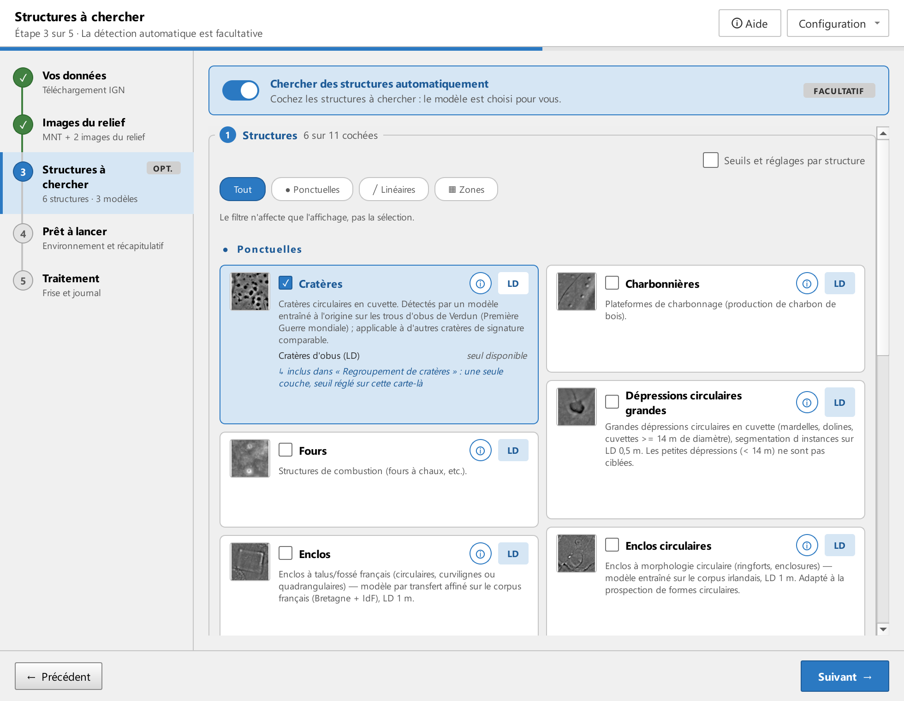
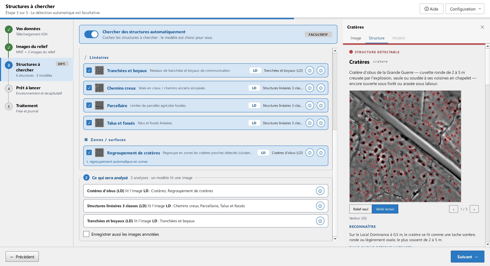
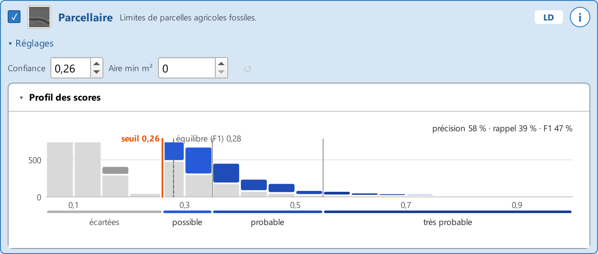

# Étape 3 · Structures à chercher

La détection est facultative : tant qu'elle est désactivée, le traitement s'arrête après les images. Activez-la, puis cochez les **structures** à chercher. Vous ne choisissez pas de modèle : pour chaque structure, le plugin retient le modèle entraîné pour elle et l'image du relief sur laquelle il a appris.

Un clic n'importe où sur le bandeau du haut (le titre, la phrase ou l'interrupteur) active ou désactive la détection.

## Les structures

Une ligne par structure, rangée sous sa morphologie.

| Morphologie | Structures |
|---|---|
| Circulaires et ponctuelles | Cratères · Charbonnières · Fours · Dépressions circulaires grandes · Enclos · Enclos circulaires |
| Linéaires | Tranchées et boyaux · Chemins creux · Parcellaire · Talus et fossés |
| Zones | Regroupement de cratères |

La liste dépend des modèles installés : une structure n'apparaît que si un modèle la couvre ; sans modèle, la ligne est grisée et le dit.

## La ligne d'une structure

- **Cocher une structure** : cliquez n'importe où sur sa ligne. Au clavier, Tab passe de ligne en ligne et Espace coche. Sur une ligne cochée, la partie réglages qui s'ouvre dessous ne coche ni ne décoche : un clic sur le seuil, la figure ou les paramètres de regroupement sert seulement à régler.
- **Vignette** : un clic sur elle ouvre la fiche du modèle qui détecte la structure, dans sa propre fenêtre. **Description** : une phrase ; si elle est coupée par « … », son texte complet est en infobulle.
- **Image requise** : le sigle de l'image sur laquelle le modèle travaille. Si elle n'est pas cochée à l'étape 2, le sigle passe en orange et un lien **l'ajouter** la coche.
- **Modèle ▾** : seulement quand plusieurs modèles couvrent la structure, sur une ligne cochée ; le menu coche le modèle retenu et chaque entrée indique le nombre de **fenêtres d'analyse** que le modèle découpe dans une dalle : c'est un fait sur le volume de calcul, pas une estimation de durée. Le nom du modèle n'est pas sur la ligne : il se lit dans **Ce qui sera analysé**, sous la liste, une phrase par modèle avec son **ⓘ** qui ouvre la fiche du modèle, dans la fiche de la structure, et d'un clic sur la vignette de la ligne.
- Le **ⓘ** en bout de ligne ouvre la fiche de la structure.
- **▸ Réglages**, sous la ligne cochée, déplie ses seuils et réglages (voir plus bas), comme pour une image à l'étape 2.
- **Regrouper en zones** : pour certaines structures, une case sous la ligne regroupe les détections proches en zones. Le **Regroupement de cratères** est une structure à part entière, avec le badge **regroupement automatique** : la cocher produit les zones et les cratères qui les composent ; elle coche d'office **Cratères**, dont la ligne prend le badge « inclus dans » et perd son réglage de seuil : une seule couche de cratères, au seuil réglé sur la ligne du regroupement.

## Les fiches

Un bouton **ⓘ** ouvre sa fiche dans une **fenêtre à part**, qui ne bloque pas l'assistant : vous lisez la fiche et vous cochez en même temps, vous changez d'étape, la fiche reste ouverte. La fenêtre se déplace et se redimensionne comme vous voulez ; **Fermer** ou la touche **Échap** la ferme.

Une fenêtre par sorte de fiche, **Image**, **Structure** et **Modèle** : ouvrir une autre structure remplace la fiche dans sa fenêtre, à la même place ; la fiche du modèle s'ouvre à côté de celle de la structure, pour les lire ensemble.

Quand plusieurs classes portent la structure (une comparaison de deux modèles, un regroupement et ses détections sources), une liste en tête de la fiche passe de l'une à l'autre.

### La fiche d'une structure

La fiche se lit dans l'ordre des questions qu'on se pose avant de cocher : à quoi ressemble la structure sur le relief, dans quelle optique l'utiliser et ce que le modèle ne détecte pas, dans quel corpus et sur quel terrain il l'a apprise, sa fiabilité mesurée avec le **profil des scores** (les détections de l'évaluation rangées par score, les vraies en couleur et les fausses en gris, avec les coupures des quatre niveaux), ses limites, puis le contexte technique. Depuis la fiche, le lien **Fiche du modèle** ouvre la fiche du modèle dans sa propre fenêtre.

En « Vérité terrain », les contours des objets annotés sont tracés dans la couleur de la couche de la classe, celle que vous retrouvez dans QGIS. Dans « Ce que le modèle a appris », une petite carte montre les zones où la structure a été apprise et mesurée, chacune en disque de la couleur de sa couche, d'autant plus grand qu'elle compte d'objets annotés ; à côté, la liste des zones avec leurs effectifs. Survoler une zone de la liste ou un disque de la carte met les deux en valeur : la ligne se teinte et le disque s'entoure.

Fiche de structure et fiche de modèle se distinguent d'un coup d'œil : la première porte un liseré et l'étiquette « Structure détectable » dans la couleur de sa couche, la seconde un liseré ardoise, l'étiquette « Modèle de détection » et la liste des structures qu'il détecte, chacune avec sa pastille de couleur.

## Comparer deux modèles

Quand deux modèles couvrent une structure, cochez-les tous les deux dans le menu **Modèle ▾**. La structure est détectée deux fois, une fois par modèle ; les sorties portent le nom du modèle et QGIS les charge dans un même groupe marqué « comparaison », pour les superposer.

## Réglages par structure

Sous chaque ligne cochée, le lien **▸ Réglages** déplie, pour cette structure seulement :

- **Confiance** : le seuil sous lequel les détections sont écartées, à deux décimales. Le défaut vient du modèle, fixé à son évaluation ; il est choisi un peu en dessous du point d'équilibre entre précision et rappel, parce qu'en prospection une structure manquée ne se rattrape pas alors qu'une fausse détection s'écarte en quelques secondes sur le relief. Certains modèles ont un seuil à trois décimales (0,245) : la case l'affiche arrondi, mais tant que vous n'y touchez pas c'est bien le seuil du modèle qui s'applique, et l'infobulle de la case le dit à trois décimales. Baisser le seuil augmente le rappel et les fausses détections ; le monter fait l'inverse. Sous le seuil du modèle, les détections ajoutées sont fusionnées entre elles, jamais avec celles qui passaient déjà le seuil, et prennent le niveau **douteux**, avec la part de vrais mesurée pour cet intervalle quand le modèle la fournit, sinon « non mesurée » : les autres niveaux gardent leurs coupures.
- **Aire min** des détections conservées, en mètres carrés. Elle ne vaut que pour cette structure, même quand un seul modèle en détecte plusieurs (parcellaire, talus et chemins creux, par exemple).
- Le bouton **↺** remet cette seule structure aux valeurs du modèle ; son infobulle nomme le seuil vers lequel il revient.
- **▸ Profil des scores** : quand le modèle est livré avec son évaluation, une section repliable montre le profil en miniature : les barres grises sont les fausses détections du banc d'évaluation, les barres colorées les vraies, et la ligne orange du seuil suit la valeur que vous saisissez. Au-dessus, la précision, le rappel et le F1 mesurés au banc pour ce seuil ; le pointillé marque le point d'équilibre. Sous l'axe, une barre découpée en segments montre la plage de scores de chaque niveau, dans sa teinte de la légende, avec son nom dessous. Survoler la figure dit ce que votre réglage change par rapport au seuil du modèle : détections correctes et fausses détections gagnées ou perdues sur le banc. Ces chiffres sont ceux du banc, sur votre terrain ils varient ; ils donnent le sens et l'ordre de grandeur d'un réglage, pas une promesse.
- Pour les regroupements : distance maximale entre deux détections, nombre minimal de détections, confiance minimale pour ouvrir une zone (quand le modèle le prévoit, les détections un peu en dessous s'y rattachent sans en ouvrir, et ce seuil de rattachement suit le réglage), aire minimale d'une zone, marge autour de la zone. Les enclos et les axes linéaires ont leurs propres réglages (fermeture, élongation, longueur minimale…), expliqués en infobulle.

Chaque réglage est indépendant : régler la confiance ne fige pas l'aire minimale, qui continue de suivre le modèle si vous en changez. Les réglages d'une structure que vous décochez sont conservés : la recocher les retrouve ; le traitement ne tient compte que des structures cochées.

> Le seuil est appliqué après le regroupement : des détections sous le seuil peuvent encore contribuer à une zone, puis disparaître de la couche des détections individuelles.

## Fiabilité affichée

Un score de modèle n'est pas une probabilité, et son échelle change d'un modèle à l'autre. Dans QGIS, la légende d'une couche de détections n'affiche donc pas le score mais une **fiabilité** en quatre niveaux, mesurée à l'évaluation du modèle : **douteux**, **possible**, **probable**, **très probable**. Le mot veut dire la même chose pour tous les modèles ; seuls les scores de coupure changent, par classe. L'infobulle de la couche et son résumé dans le panneau des couches donnent la part mesurée de vrais objets pour chaque niveau. Voir [Vos résultats dans QGIS](resultats.md#la-legende-de-fiabilite).

La **fiche** d'une classe montre le profil complet : les quatre niveaux sous l'axe avec leur part mesurée et leur effectif, une ligne pointillée au point d'équilibre entre précision et rappel (le seuil du modèle est choisi en dessous), le bilan du seuil réglé, et, quand l'évaluation couvre plusieurs zones, un petit profil par zone : une classe peut être sûre dans une forêt et plus faible dans une autre. En haut à droite de la figure, la précision et le rappel mesurés au banc pour le seuil courant. La case **Tester un seuil** de la fiche déplace la ligne, recalcule les niveaux, la précision et le rappel, sans changer le seuil du traitement : c'est un essai, le seuil appliqué reste celui de la ligne. Sur les petits profils par zone, le rappel est recalculé à partir des objets annotés de la zone ; il n'existe pas pour les classes linéaires, évaluées par la distance de leur axe aux tracés annotés (ou, pour une évaluation plus ancienne, par recouvrement), où la vérité est une longueur de tracé et non des objets. Survolez une barre pour ses effectifs ; un clic droit sur la figure l'enregistre ou la copie, pour un rapport ou une présentation. En comparaison de deux modèles, la figure prend la couleur de la couche de ce modèle, comme la légende. Quand vous avez saisi des verdicts dans QGIS (voir [Valider les détections](resultats.md#valider-les-detections)), chaque niveau de la fiche ajoute « chez vous : 64 % sur vos 85 vérifications » : le banc est un plancher annoncé, le terrain dit ce qu'il vaut ici.

## Objets à cheval sur deux dalles

Les images analysées débordent de la dalle, grâce à la marge de l'étape 2 ou, en point de départ Images du relief existantes, grâce aux dalles voisines du dossier. Un objet coupé par le bord est vu entier par l'une des deux dalles, et chaque dalle ne rapporte que les détections dont le centre est chez elle : pas de doublon et pas de fragment au bord.

## Récapitulatif

La carte **Ce qui sera analysé** dit, en une phrase par analyse, quel modèle lit quelle image pour quelles structures : « Modèle cratères lit l'image LD : Cratères ». Un modèle travaille toujours sur une seule image ; le **ⓘ** de la phrase ouvre sa fiche. La case **Enregistrer aussi les images annotées** produit en plus des images avec les détections dessinées, rangées dans la zone technique du dossier de sortie.

À la fin du traitement, le journal donne pour chaque modèle le nombre d'images analysées et la durée mesurée, pour comparer deux modèles sur un cas réel.
