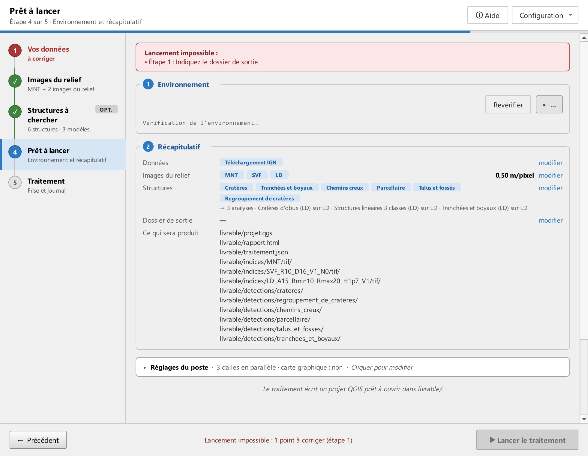
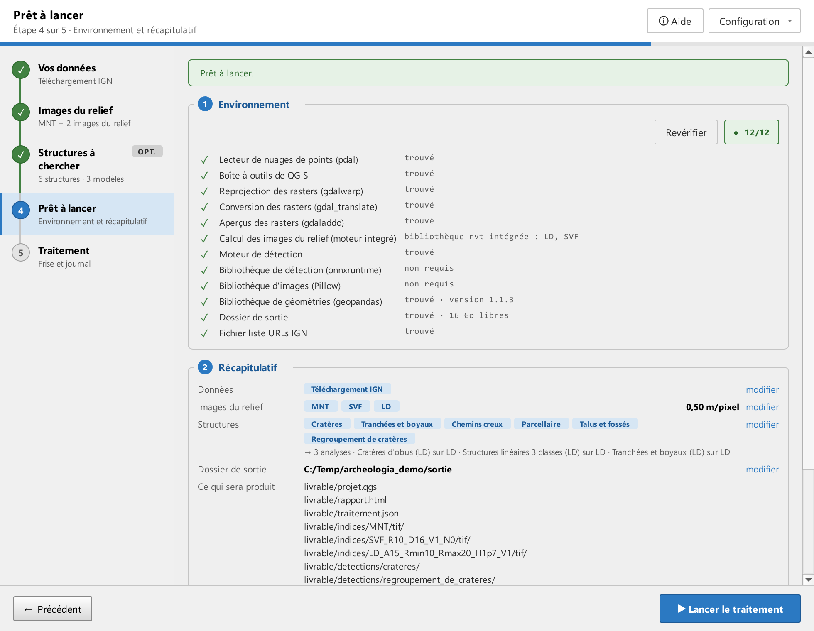

# Étape 4 · Prêt à lancer

Avant de lancer, cette étape vérifie que tout est prêt et reprend vos choix. **Lancer le traitement**, en bas à droite, démarre le traitement et ouvre l'[étape 5](etape-5-traitement.md), où il se suit.

## Le bandeau

Le bandeau du haut dit où vous en êtes, en quatre états :

- **Lancement impossible** (rouge) : il manque un choix. Les points à corriger sont rangés par étape (« Étape 1 : Indiquez le dossier de sortie ») et le rail de gauche marque l'étape « à corriger ». Le bouton **Lancer le traitement** est grisé, et à sa gauche une ligne dit pourquoi : « Lancement impossible : 2 points à corriger (étapes 1, 2) ». Un réglage d'image hors des bornes de l'algorithme (une configuration modifiée à la main, par exemple) en fait partie, avec le nom du champ : lancé tel quel, il ferait échouer chaque dalle après le téléchargement et le MNT.
- **Vérification de l'environnement** (gris) : les contrôles du poste tournent, quelques secondes.
- **Un outil manque** (rouge) : un contrôle indispensable a échoué ; le bandeau le nomme et un lien ouvre l'aide sur [Dépannage](depannage.md#les-verifications-prealables-ont-echoue). Le bouton reste actif, mais le traitement s'arrête aussitôt sur ses vérifications préalables.
- **Prêt à lancer** (vert), ou **Prêt à lancer, avec un avertissement** (orange) quand un contrôle non indispensable a échoué, en le nommant.

## Environnement

Le panneau vérifie en tâche de fond ce dont le traitement a besoin, chaque contrôle sous son nom en français :

- le lecteur de nuages de points (pdal), la reprojection, la conversion et les aperçus des rasters (les outils gdalwarp, gdal_translate et gdaladdo) ;
- la boîte à outils de QGIS et le calcul des images du relief par le moteur intégré (la bibliothèque Relief Visualization Toolbox livrée avec le plugin) ;
- si la détection est activée, le moteur de détection et ses bibliothèques ;
- le dossier de sortie, avec les Go libres du disque, l'entrée du point de départ (liste de dalles, dossier des nuages, des MNT ou des images) et le système de coordonnées des rasters en MNT ou Images du relief existantes.

Chaque ligne porte son état et un mot : **trouvé**, **manquant**, **non requis**, une version. Le chemin trouvé ou le message d'erreur complet est en infobulle, sur ce mot ; le nom technique du contrôle est en infobulle sur son libellé. Le bouton **Revérifier** relance les contrôles, après avoir installé un outil par exemple.

## Récapitulatif

Le récapitulatif reprend vos choix : point de départ, images du relief, structures et modèles, dossier de sortie. Chaque section porte un lien **modifier** qui ramène à son étape ; **Suivant** revient ensuite ici. **Ce qui sera produit** liste ce que le traitement écrira dans le dossier de sortie : le projet QGIS, le rapport, la trace du traitement, un dossier par image cochée (son nom porte les réglages, pour que deux traitements aux réglages différents cohabitent) et un dossier par structure cochée. Voir [Vos résultats dans QGIS](resultats.md).

## Réglages du poste

**Dalles traitées en parallèle** : le nombre de dalles téléchargées, fusionnées avec leurs voisines et préparées pour la détection en même temps. Le MNT et les images, eux, sont calculés une dalle après l'autre. Plus de dalles en parallèle accélère ces étapes sur une machine à plusieurs cœurs mais consomme plus de mémoire : si une dalle échoue dans PDAL, voir [Erreur PDAL ou mémoire](depannage.md#erreur-pdal-ou-memoire).

**Détection sur la carte graphique** (Windows, décochée par défaut) : la détection est de loin l'étape la plus longue d'un traitement, et une carte graphique l'exécute plusieurs fois plus vite que le processeur. Cochée, l'option fait vérifier la carte par le moteur de détection au premier usage de chaque modèle sur votre poste : la première image est analysée sur le processeur, puis rejouée sur chaque carte de la machine. Une carte n'est gardée que si elle est nettement plus rapide et donne les mêmes détections que le processeur, à une bascule près pour les objets proches du seuil (à moins de 0,10 au-dessus). Le journal dit ce qui a été décidé, avec les durées mesurées ; la décision est mémorisée pour ce poste, ce modèle et cette version du moteur, et un refus est réessayé après sept jours. Si la carte échoue en cours de traitement, la détection continue sur le processeur et le journal le dit : aucune image n'est perdue. Le rapport et `traitement.json` notent l'appareil employé. Une carte intégrée au processeur est souvent plus lente que lui et sera écartée ; une session de bureau à distance aussi. Voir [Dépannage](depannage.md#la-carte-graphique-n-est-pas-utilisee).

Sous la case, l'étape montre la **décision mémorisée pour ce poste** (la carte retenue ou le processeur, avec sa date et le motif) et le bouton **Oublier**, qui l'efface : au prochain traitement, la carte est de nouveau comparée au processeur. Sans décision mémorisée, rien ne s'affiche.

## Pendant un traitement

L'étape reste consultable pendant un traitement, en lecture seule comme les étapes 1 à 3 : la pastille de l'en-tête le signale, et les réglages du poste du traitement en cours ne se changent plus ; **Revérifier** et les liens **modifier** restent utilisables. Le bouton du bas devient **Suivant** et ramène au suivi, à l'étape 5.
