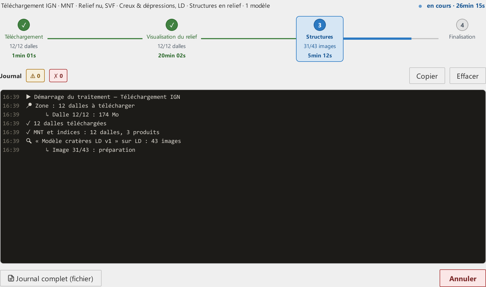
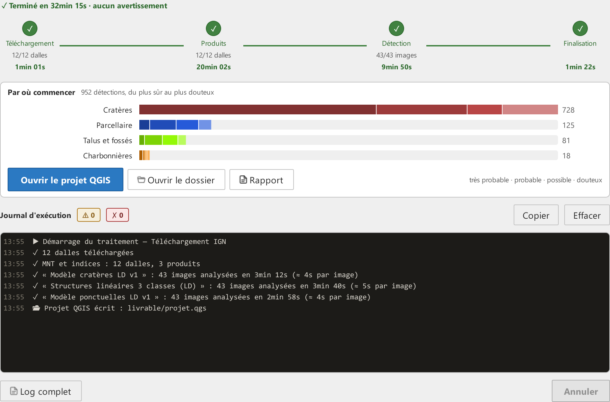

# Étape 5 · Traitement

**Lancer le traitement**, à l'[étape 4](etape-4-verifications.md), ouvre cette étape. Elle est consultable avant même le lancement et montre alors ce qui a été choisi : la ligne du haut résume le point de départ, les produits et les modèles, et la frise annonce les phases du point de départ, Téléchargement, Visualisation du relief, Structures, Finalisation.

## Pendant le traitement

- la **frise** porte l'état : la phase en cours est encadrée, avec son compteur mesuré (dalles, images) et son chronomètre ; le fil qui la suit se remplit à proportion de ce compteur, et passe au vert quand la phase est faite. Le chronomètre total est à droite de la ligne du haut ;
- le **journal** : un message par événement, dans le vocabulaire de cette aide. Les pastilles **⚠** et **✗** comptent les avertissements et les erreurs et filtrent l'affichage ; **Copier** et **Effacer** agissent sur le texte affiché.

Rien n'est estimé : une phase sans compteur montre son chronomètre, pas un pourcentage.

Pendant le traitement, les étapes 1 à 4 restent consultables mais en lecture seule, signalé par une pastille dans l'en-tête. **Annuler** arrête au prochain point de contrôle, en quelques secondes (le journal dit « Annulation demandée… patientez quelques secondes »), y compris pendant un téléchargement qui n'avance plus ; ce qui est déjà écrit est gardé.

### Lire le journal

- **▶ Démarrage**, puis les vérifications préalables.
- **Téléchargement** : les dalles identifiées, puis chaque dalle téléchargée, ou « déjà présente (vérifiée) » si un lancement précédent l'a laissée sur le disque après l'avoir lue en entier : elle n'est alors pas relue.
- **Fusion des dalles avec leurs voisines** : la marge est constituée.
- **Visualisation du relief** : une ligne par dalle, puis par modèle de terrain.
- **Détection** : une ligne par modèle, nommé comme à l'étape 3, puis par image analysée ; à la fin de chaque modèle, le nombre d'images et la durée mesurée ; à la fin de la détection, le nombre de détections gardées dans les couches, après dédoublonnage entre dalles, seuil et aire minimale. Sans structure cochée, en point de départ Indices de visualisation existants, une seule ligne « Publication des images ».
- **Assemblage** : mosaïques, GeoPackages, puis « Projet QGIS écrit : livrable/projet.qgs » ; le nombre de couches ajoutées ne s'affiche qu'au clic sur **Ajouter au projet QGIS courant**.

Un **⚠** signale quelque chose qui n'arrête pas le traitement mais mérite d'être lu : un raster trop petit pour le rayon d'un indice, une dalle écartée. Un **✗** est une erreur ; si le traitement s'interrompt, le message en donne la cause et nomme le journal complet (`technique/journaux/pipeline_log_<date>.txt`), qui porte le détail technique ; les lignes dites avant son ouverture (avertissements de la configuration, lancement) y sont reportées. Quand ce manuel a une rubrique pour le message, la ligne se termine par « voir Aide › Dépannage › … » : un clic l'ouvre directement.

## À la fin

La ligne du haut devient la synthèse : « Terminé en 32min 15s · aucun avertissement », en vert ; en gris pour une annulation, en rouge pour un échec avec le nombre d'avertissements et d'erreurs. Quand le moteur de détection s'arrête en cours de route, la ligne dit en rouge « ✗ Détection impossible » avec sa cause : les images sont calculés, mais pas les détections du modèle en cause (quand deux modèles sont comparés, l'autre a détecté normalement et la ligne nomme celui qui a échoué) ; le rapport et la trace du traitement le disent aussi. Voir [La détection est impossible](depannage.md#la-detection-est-impossible). Chaque phase de la frise garde sa durée mesurée.

Sous la frise, le cadre **Par où commencer** : pour chaque structure, une barre des détections par niveau, du plus sûr au plus douteux, dans la couleur de la couche, avec son total : celui des détections gardées dans la couche, après l'aire minimale. Sous chaque barre, les effectifs par niveau en toutes lettres (« très probable 120 · probable 80 · possible 40 · douteux 12 ») : le bilan se lit sans la couleur. C'est la réponse à « par où commencer ? » : les **très probables** d'abord. Le même bilan est dans le journal, dans le rapport et dans la trace du traitement.

Les couches **ne sont pas chargées dans QGIS automatiquement**. **Ajouter au projet QGIS courant** charge les mosaïques et les couches de détections, stylées, dans votre projet ouvert, une seule fois. Le projet `livrable/projet.qgs` est écrit dans tous les cas : il s'ouvre comme tout projet QGIS, depuis le menu Projet ou par « Ouvrir le dossier », plus tard ou sur un autre poste.

Un **rapport** du traitement (`rapport.html`) est écrit dans `livrable/` et s'ouvre dans le navigateur avec le bouton **Rapport** du même cadre : une mise en garde d'usage, le point de départ, la surface couverte, le nombre de dalles et le système de coordonnées des couches, les images avec leurs réglages en mots, chaque modèle sous son nom avec le seuil appliqué (un par classe quand le modèle en fixe un pour chacune, les linéaires par exemple),
 le nombre d'images analysées et la durée mesurée, le bilan de fiabilité en barres dans les couleurs des couches comme dans QGIS, avec les mêmes libellés qu'à l'écran, ce que garantit chaque niveau et la densité de détections au km², les durées par étape, les avertissements du journal avec leur renvoi au manuel, les sources des données et des outils, et une vignette de la zone ; quand les sites traités sont dispersés (moins d'un quart de l'emprise couverte), la vignette est une planche des fenêtres les plus grandes, côte à côte, sans leur position relative. La surface couverte est celle des emprises réunies : deux fenêtres qui se recouvrent ne comptent qu'une fois. Il ne situe pas la zone : aucun nom de dalle, aucune coordonnée, aucun chemin de votre poste, et les avertissements sont débarrassés de leurs chemins. Il se lit hors ligne et s'imprime : c'est le document à joindre au dossier de prospection.

**Ouvrir le dossier**, dans le même cadre, ouvre le dossier de sortie dans l'explorateur de fichiers. En bas, **Journal complet (fichier)** ouvre le journal détaillé.

Le journal reste là : revenir sur une autre étape puis sur l'étape 5 le retrouve tel quel, jusqu'au lancement suivant. **Lancer le traitement**, en bas de l'étape 4 comme de celle-ci, relance avec les réglages en cours ; depuis les étapes 1 à 3, après un premier traitement, **Relancer maintenant** dans la barre du bas fait de même sans repasser par l'étape 4, et y ramène si un point reste à corriger.

Ce que contient le dossier et comment lire les couches : [Vos résultats dans QGIS](resultats.md).

## Relancer dans le même dossier

Vous pouvez relancer un traitement dans un dossier de sortie déjà utilisé, par exemple pour ajouter un produit ou une structure :

- un produit déjà calculé avec les mêmes réglages n'est pas recalculé ;
- un produit relancé avec d'autres réglages va dans un dossier distinct, dont le nom porte les réglages ;
- une détection relancée avec un autre modèle, un autre seuil ou après une mise à jour du moteur de détection est refaite ; à réglages identiques, les images déjà analysées ne le sont pas de nouveau ;
- les mosaïques sont régénérées et les couches périmées retirées du projet QGIS au lancement, pour que les nouvelles dalles apparaissent ;
- un dossier calculé par une version précédente du plugin, ou des réglages de fusion ou de MNT changés depuis, refont une fois la fusion, le MNT et les indices : le journal le dit par « ⚠️ Méthode de calcul mise à jour » ou « ⚠️ Paramètres de traitement modifiés », voir [Méthode de calcul mise à jour](depannage.md#methode-de-calcul-mise-a-jour).

Les sorties intermédiaires ne sont jamais supprimées par le plugin : vous pouvez les effacer vous-même une fois satisfait, voir [Faire de la place](resultats.md#faire-de-la-place).

Un dossier de sortie écrit par une version précédente du plugin est réorganisé en `livrable/` et `technique/` au lancement, après votre accord : voir [Vos résultats dans QGIS](resultats.md).
