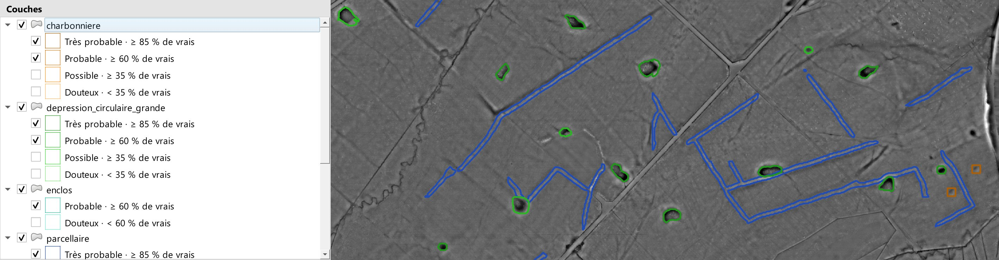

# Vos résultats dans QGIS

## Le dossier de sortie

Deux dossiers, une règle : `livrable/` se garde et se transmet, `technique/` se supprime. Le [schéma de la chaîne](premier-traitement.md#ce-que-fait-le-plugin) montre quelle phase écrit chaque dossier.

```
dossier_de_sortie/
├── livrable/                          ce que vous gardez et transmettez
│   ├── projet.qgs                     le projet QGIS stylé : le point d'entrée
│   ├── rapport.html                   le rapport, à ouvrir dans le navigateur
│   ├── traitement.json                résumé du traitement, sans chemin de votre poste
│   ├── images/
│   │   ├── MNT/tif/                   le modèle de terrain, dalle par dalle
│   │   │   └── index_MNT.vrt          la mosaïque, chargée dans QGIS
│   │   └── SVF_R10_D16_V1_N0/tif/     une image, avec ses réglages dans le nom
│   │       └── index_SVF.vrt
│   └── detections/
│       ├── parcellaire/parcellaire.gpkg   un GeoPackage par structure
│       └── parcellaire/fiabilite.json     les coupures de fiabilité de cette couche
└── technique/                         ce que vous pouvez supprimer
    ├── sources/dalles/                dalles LiDAR, re-téléchargeables ; à côté :
    │                                  une note « .verifie.json » (lue en entier)
    │                                  et « .partial » après une coupure
    ├── intermediaires/                fichiers de calcul par dalle
    ├── png/                           images préparées pour la détection
    ├── detection/<modèle>/            sorties brutes et images annotées
    └── journaux/                      un journal et une trace complète par lancement
```

Copier `livrable/` suffit à transmettre un traitement : le projet QGIS y retrouve ses couches par des chemins relatifs. Supprimer `technique/` libère la place ; un traitement relancé re-télécharge ou recalcule ce qui manque.

### Le nom d'un dossier d'image

Le dossier d'une image porte ses réglages : `SVF_R10_D16_V1_N0` est un facteur de vue du ciel à rayon 10 pixels, 16 directions, exagération 1, sans suppression de bruit ; `LD_A15_Rmin10_Rmax20_H1p7_V1` une dominance locale avec ses rayons et sa hauteur d'observation. Une sortie flottante (« Sauver en 8 bits » décoché) ajoute `_F32` au nom : `SVF_R10_D16_V1_N0_F32`. Relancer avec d'autres réglages, ou en passant du 8 bits au flottant, crée un autre dossier au lieu d'écraser le premier. Le MNT, la densité et la couverture rangent leurs fichiers dans un dossier au nom seul ; le nom de chaque MNT porte sa résolution (`…_MNT_A_0M50_…` à 0,5 m, `…_MNT_A_1M00_…` à 1 m), celle du MNT fourni en point de départ MNT existant. Relancer à une autre résolution dans le même dossier remplace le MNT de chaque dalle : la mosaïque ne mélange jamais deux résolutions. En point de départ Images du relief existantes, tout va sous `livrable/images/RVT/`.

Dans chaque dossier `tif/`, la mosaïque `index_<PRODUIT>.vrt` assemble toutes les dalles : c'est elle que QGIS charge, sous le même nom. Chargée à la main, elle reste reconnaissable.

## Le projet de validation

`livrable/projet.qgs` est écrit à la fin de chaque traitement et constitue le point d'entrée pour valider les détections. Il contient les mosaïques des images du relief et, par structure, un groupe avec sa couche de détections stylée. Deux modèles comparés sur une même structure donnent deux couches dans un groupe marqué « comparaison ».

Les mêmes couches sont chargées dans votre projet QGIS courant quand vous cliquez **Ouvrir le projet QGIS** à la fin du traitement, une seule fois ; rien ne se charge sans ce clic.

## La légende de fiabilité

Chaque couche de détections est catégorisée en quatre niveaux : **douteux**, **possible**, **probable**, **très probable**. Un niveau est défini par la part de vrais objets mesurée à l'évaluation du modèle dans la bande de scores correspondante : au moins 35 % pour possible, 60 % pour probable, 85 % pour très probable. Le mot veut donc dire la même chose pour tous les modèles ; seuls les scores de coupure changent.

Le dessin : contour seul, sans remplissage, pour laisser lire la structure détectée dessous ; une couleur par classe, déclinée du plus foncé (très probable) au plus clair (douteux). L'infobulle de la couche et son résumé, dans les propriétés, donnent la part mesurée pour chaque niveau et le nombre de détections sur lequel elle a été mesurée.

À l'ouverture, seuls **très probable** et **probable** sont cochés dans la légende ; **possible** et **douteux** y sont, décochés. Commencez par ce qui est sûr, puis cochez les deux autres niveaux d'un clic dans le panneau des couches pour élargir : toutes les détections sont dans le GeoPackage, dans le bilan de fin de traitement et dans le rapport. L'état des cases est enregistré dans le projet ; une couche chargée depuis le bouton « Ouvrir le projet QGIS » s'ouvre de la même façon.

Quand vous avez baissé le seuil d'une structure sous celui du modèle, les détections ajoutées forment le niveau **douteux · sous le seuil du modèle** : la part de vrais y est celle mesurée pour cet intervalle quand le modèle la fournit, sinon « non mesurée » ; les autres niveaux gardent leurs coupures. Ces détections sont fusionnées entre elles, jamais avec celles qui passaient déjà le seuil : un bon polygone n'est pas tiré vers le bas par un fragment faible accolé. L'infobulle d'une détection dit, pour un polygone fusionné, de combien de fragments il est fait et le score du plus sûr.

[](img/resultats-legende-fiabilite.jpg)

Pour voir d'où viennent les coupures d'une classe, ouvrez sa fiche à l'étape 3 : le **profil des scores** range les détections de l'évaluation par score, vraies en couleur et fausses en gris, et trace les coupures. Sous le seuil, presque tout est faux ; au-dessus de la dernière coupure, presque tout est vrai.

Une couche issue d'un modèle sans fiabilité mesurée est catégorisée par tranches de score.

## Les attributs d'une détection

| Attribut | Contenu |
|---|---|
| `model_pred` | la classe prédite par le modèle |
| `confidence` | le score du modèle, entre 0 et 1 |
| `fiabilite` | le niveau de fiabilité affiché dans la légende |
| `fiabilite_pct` | la part de vrais objets mesurée pour ce niveau, en pour cent |
| `conf_bin` | la tranche de score, pour les modèles sans fiabilité mesurée |
| `n_membres` | le nombre de fragments fusionnés dans ce polygone (1 : détection isolée) |
| `conf_max` | le score du fragment le plus sûr ; `confidence` est la moyenne pondérée par l'aire |
| `longueur_m` | la longueur du polygone, en mètres (celle d'un rectangle de même aire et de même périmètre : la longueur d'un tracé, sans sens particulier pour une forme trapue) |
| `model_name` | le modèle qui a produit la détection |
| `cluster_id` | le regroupement auquel la détection appartient, le cas échéant |
| `corr_pred`, `validation` | deux champs vides, à votre usage pour corriger la classe et noter votre verdict |

Les zones issues d'un regroupement portent en plus le nombre de détections qu'elles contiennent, leur surface en mètres carrés, leur densité par hectare, le score que dépassent les 10 % de détections les mieux notées (`conf_p90`) et l'élongation médiane des détections (`elong_med`).

## Valider les détections

Ouvrez le projet de validation, parcourez une couche de détections avec l'image sur laquelle le modèle a travaillé en dessous, et renseignez `validation` au fil de l'eau avec l'un des trois verdicts du formulaire : **oui** (vrai objet), **non** (fausse détection), **peut-être** (à revoir). Si la classe réelle est une autre, notez-la dans `corr_pred`. Ces verdicts servent ensuite : la fiche d'une classe (étape 3) affiche, à côté de la part de vrais objets mesurée au banc, la part observée **chez vous**, niveau par niveau, sur les traitements lancés depuis ce poste. Les détections **douteux** valent le coup d'œil mais rarement plus : en prospection, une fausse détection s'écarte en quelques secondes, une structure manquée ne se rattrape pas, c'est pourquoi le seuil par défaut laisse passer cette catégorie.

Pour une dalle, les détections de toutes les structures se superposent sans doublon aux bords : chaque dalle ne rapporte que les objets dont le centre est chez elle.

## Les traces d'un traitement

`livrable/traitement.json` résume le dernier traitement : version du plugin, date, nombre de dalles, version de PDAL qui a calculé le MNT et méthode de fusion des nuages, images du relief et leurs réglages, modèles lancés avec l'appareil qui a détecté (processeur ou carte graphique, et son nom), structures produites avec le chemin de leur GeoPackage, le bilan de fiabilité par structure, le moteur de détection employé ou, si la détection a été impossible, sa cause. Il ne porte aucun chemin de votre poste et se transmet avec le livrable.

`technique/journaux/` garde, pour chaque lancement, le journal détaillé `pipeline_log_<date>.txt` et la trace complète `metadata_<date>.json`, avec la configuration entière de l'assistant, chemins de votre poste compris. C'est ce qu'il faut joindre à une demande d'aide.

## Un MNT reproductible

La fusion de chaque dalle avec ses voisines lit les points toujours dans le même ordre : deux traitements des mêmes dalles avec la même version de PDAL, celle que note `livrable/traitement.json`, donnent le même MNT au bit près. Un dossier calculé par une version précédente du plugin voit donc son MNT, et tout ce qui en découle (images, détections), recalculé une dernière fois à la relance : le journal le signale par « Méthode de calcul mise à jour ». L'écart avec l'ancien MNT est de l'ordre de celui qu'il y avait déjà entre deux traitements identiques.

Dans les points de départ LiDAR (téléchargement IGN, LAZ local), la grille du MNT, de la densité et de la couverture est calée sur celle des dalles IGN (bords des pixels sur les multiples de la résolution) : chaque pixel publié est un pixel calculé, recadré sans rééchantillonnage, au même endroit d'un traitement à l'autre. Les MNT et densités calculés par une version précédente pouvaient être décalés d'un demi-pixel (25 cm pour un MNT à 0,5 m), dans un sens qui variait d'une dalle et d'une relance à l'autre ; la relance d'un tel dossier refait une fois sa fusion, ses MNT, sa densité et ses images (« Méthode de calcul mise à jour »). Le calage ne concerne pas un MNT fourni (point de départ MNT existant) : s'il n'est pas déjà sur les multiples de sa résolution, son recadrage au kilomètre le rééchantillonne.

## Faire de la place

Une fois le traitement validé, supprimez `technique/` : rien du livrable n'en dépend. Si vous voulez garder les nuages de points téléchargés, déplacez d'abord `technique/sources/`. Un traitement relancé dans le même dossier re-télécharge ou recalcule ce qui manque.

Sur Windows, un dossier de sortie très profond peut dépasser la limite de 260 caractères d'un chemin : choisissez un dossier de sortie court.

## Un dossier d'une version précédente

Un dossier de sortie écrit avant cette organisation garde ses anciens dossiers à la racine : `images/`, `detections/`, `intermediaires/`, `sources/`, les journaux et `metadata.json`. Au lancement d'un traitement dans ce dossier, le plugin propose de le réorganiser et attend votre accord : il montre ce qui sera déplacé, déplace sans copier, et retire du projet QGIS les couches chargées depuis les anciens emplacements, rechargées en fin de traitement. Ce qu'il ne reconnaît pas, par exemple un dossier que vous avez posé vous-même, ne bouge pas et vous est indiqué. Refusez, et le traitement n'est pas lancé : choisissez alors un autre dossier de sortie.

Certains dossiers d'images d'une version précédente ne sont plus ceux que le plugin écrit : une sortie flottante sans `_F32` dans son nom, une pente « Pourcentage » sous `SLO_U1…` (qui donnait des radians), un MSTP à l'échelle large de rvt (`…_B223-2023…`), un M-HS 8 bits avec un autre nombre de directions que 16 dans son nom. Le plugin les laisse en place et écrit le nouveau dossier à côté ; le projet QGIS du traitement charge le nouveau. Supprimez les anciens à la main si vous n'en avez plus l'usage.
