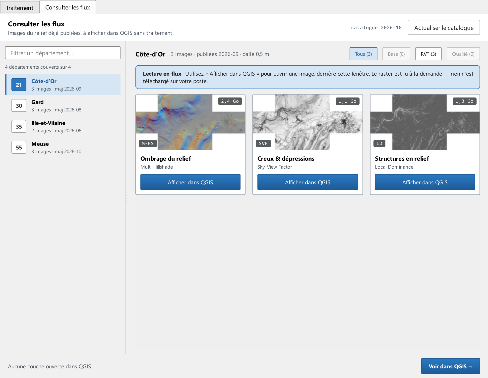

# Consulter les flux

Le second onglet de la fenêtre, à côté de **Traitement**, affiche des images du relief déjà publiées par votre organisation, sans rien calculer ni télécharger : vous choisissez un département, une image, et elle s'ouvre dans QGIS, lue à la demande. C'est le chemin le plus court quand la zone qui vous intéresse a déjà été traitée et publiée.

## Le catalogue

Ce que l'onglet montre vient d'un **catalogue** installé avec le plugin par votre organisation : la liste des départements publiés et, pour chacun, les images disponibles avec leur date de publication, leur résolution et leur poids. Le plugin seul n'en contient pas. En haut à droite, la date du catalogue ; **Actualiser le catalogue** le relit, après une mise à jour par votre organisation.

Sans catalogue sur le poste, la page le dit : « Aucun catalogue n'est installé sur ce poste : cette page sert aux flux publiés par votre organisation », avec un lien vers ce chapitre. Ce n'est pas une panne. Un catalogue présent mais illisible est signalé avec son emplacement.

## Choisir un département

La colonne de gauche liste les **départements couverts**, avec le nombre d'images de chacun ; le compte « N départements couverts sur M » rappelle l'étendue de la publication. Le champ **Filtrer un département…** réduit la liste au nom ou au numéro tapé. À l'ouverture, le département mis en avant par le catalogue est sélectionné, pour que le mur soit plein tout de suite.

## Le mur d'images

À droite, le mur du département choisi : son nom, le nombre d'images et leur date de publication, puis une carte par image, avec sa vignette, son sigle, son titre tel qu'à l'étape 2 (« Creux & dépressions »), son nom technique et son poids. Les boutons **Tous**, **Base**, **RVT** et **Qualité** filtrent par famille : le relief nu, les images du relief, les cartes de qualité de la donnée.

Le bandeau au-dessus des cartes dit ce que fera le clic : en **lecture en flux**, le raster est lu à la demande et rien n'est téléchargé sur votre poste ; en **aperçu local**, le catalogue lit des rasters déjà calculés sur ce poste.

## Afficher dans QGIS

Le bouton **Afficher dans QGIS** d'une carte ouvre l'image dans votre projet QGIS courant, derrière l'assistant, sous le nom « <sigle> — <département> ». Pendant l'ouverture, la carte l'indique ; une fois la couche ouverte, la carte prend un cadre. Un clic sur une carte ouverte, ou sur sa croix, **retire la couche de QGIS**. Retirer la couche depuis le panneau des couches de QGIS remet la carte dans son état initial : les deux restent d'accord.

En bas, **Tout retirer** retire les couches ouvertes par cet onglet, et seulement elles : vos autres couches ne sont jamais touchées. **Voir dans QGIS →** réduit l'assistant pour laisser voir la carte. Le titre de l'onglet porte le nombre de couches ouvertes, « Consulter les flux (3) ».

Si une image ne s'ouvre pas, le message de QGIS en donne la raison : le flux est injoignable ou l'adresse a changé ; signalez-le à qui publie le catalogue.
